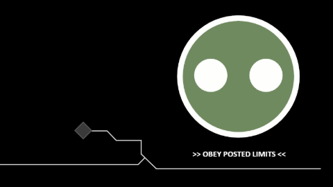

# Virgil

A live desktop wallpaper of the New Mombasa Superintendent ("Virgil") from Halo 3: ODST, for [Lively Wallpaper](https://www.rocksdanister.com/lively/).

- **Moods:** Virgil falls asleep when you're idle, turns red and angry under sustained CPU load, gets drowsy during curfew (23:00–06:00), and otherwise blinks, winks and follows your cursor.
- **Terminal:** a mood header, a scrolling log of New Mombasa status messages, and a Claude Code-style spinner word.
- **Battery:** all animation stops on battery. The scene still updates once a minute.
- **Screens:** works at 1920×1080, 2560×1440 and 3440×1440 ultrawide.

## Install

1. Download the zip.
2. In Lively, click **+** and choose the zip.
3. In Lively's settings, set wallpaper input to **Mouse** so the eyes can follow your cursor.

Settings (in Lively, under the wallpaper's customise option): idle timeout, CPU alarm threshold, face colour.

## Develop

- `scene.js` holds every rule: moods, captions, terminal, timing and layout. `render.js` draws a scene, and `main.js` connects it to Lively.
- `npm test` runs the tests for `scene.js` (Node's built-in test runner, no dependencies).
- `python tools/make-preview.py` regenerates `thumbnail.jpg` and `preview.gif`. It needs Microsoft Edge and Pillow.
- [SPEC.md](SPEC.md) has the full design and its revisions.
